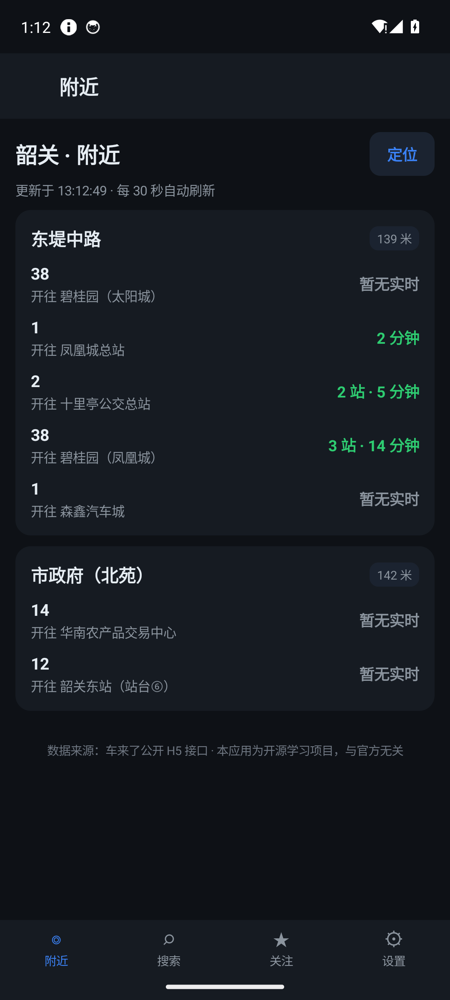
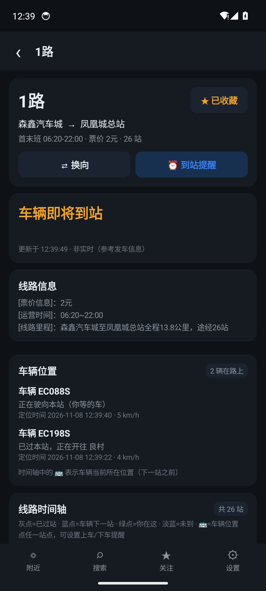
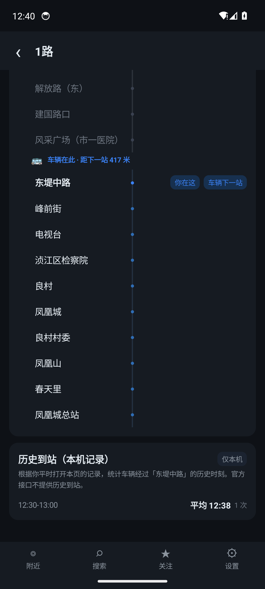
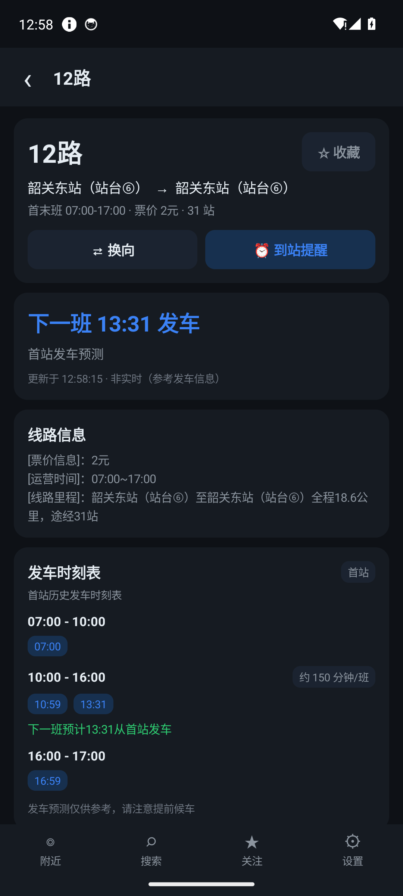
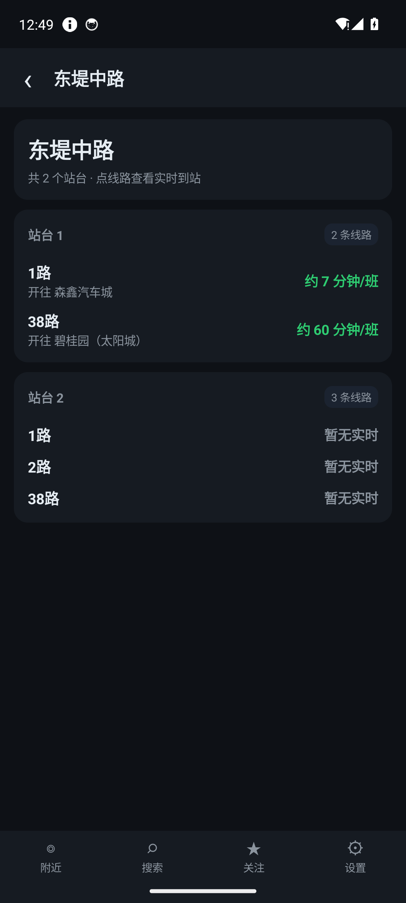
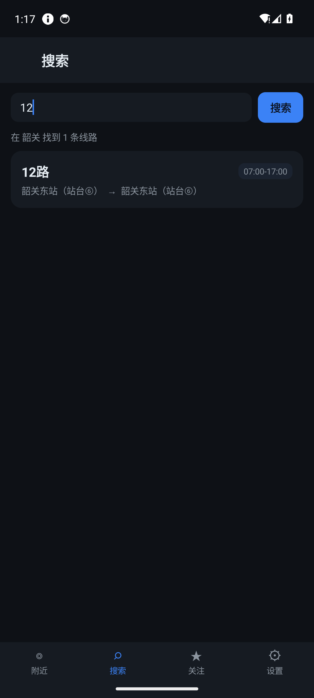
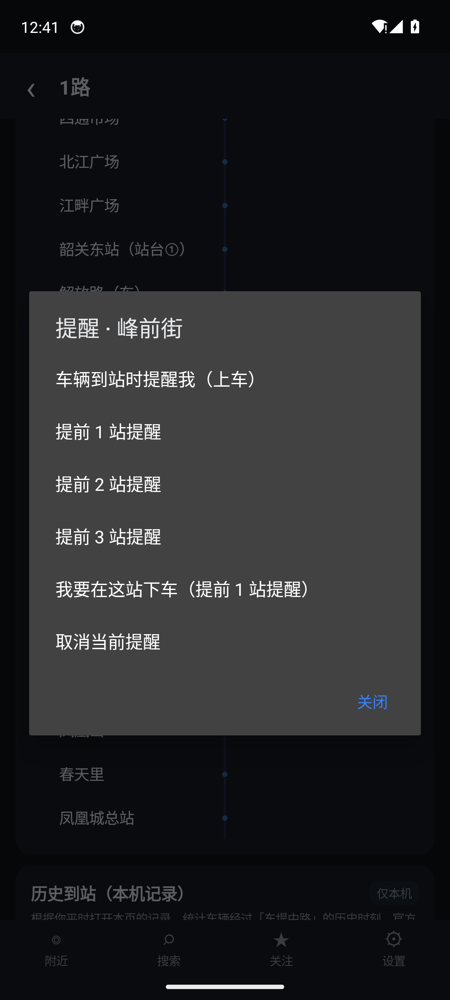
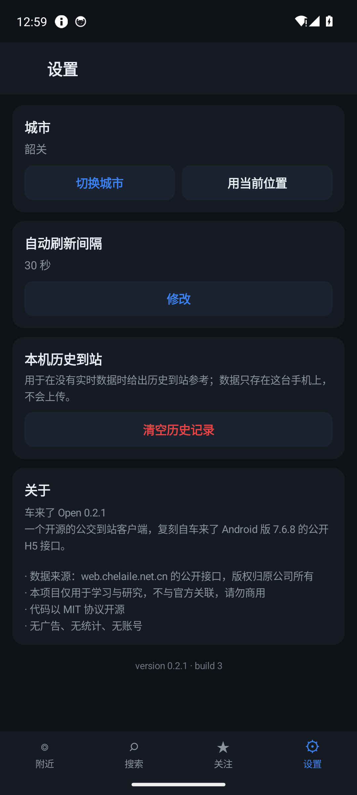
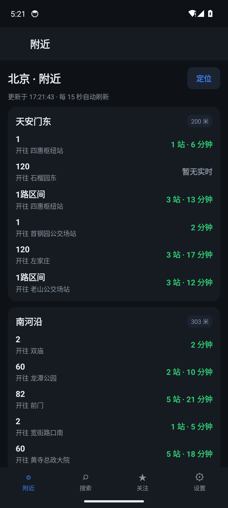
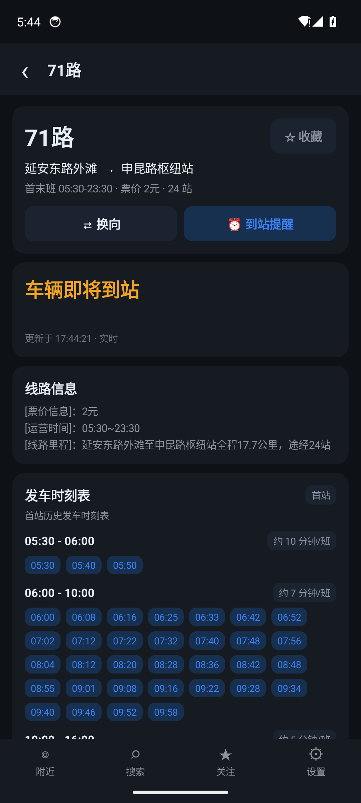

# 车来了 · 开放版（Android）

> 一个从 APK 逆向出发、完全独立实现的开源实时公交 Android 客户端。
>
> 目标应用：**车来了 7.6.8**（com.ygkj.chelaile.standard，versionCode 436）
>
> 本项目与「车来了」官方无任何关联，不含原 App 的二进制、广告、账号或统计 SDK。
>
> GitHub：https://github.com/Lumorian/chelaile-open

  
  
  
  

---

## 这是什么

「车来了」是一款国内主流的实时公交 App，核心代码用娜迦（SecNeo）DexHelper 加固。本项目没有硬脱壳，而是从 APK 字符串池与公开 H5 流量中还原出同一套网关协议，然后用**纯 Java + Android SDK** 重写了一个可运行的客户端。

交付形态是 **Android APK**，不是网页套壳：

- 无 Gradle、无 AndroidX、无 Kotlin、无第三方运行时依赖；
- 一个约 70 KB 的 APK，直接调用线上网关；
- 附近线路、搜索、线路详情、发车时刻表、换向、收藏、上下车提醒、本机历史到站；
- 深色界面，无广告、无登录、无埋点、无上传。

仓库里的 TypeScript protocol/server/web/CLI 是最初的协议研究与调试实现，保留下来用于对照和抓包复现，**不是**本项目的交付客户端。

## 功能

| 功能 | 说明 |
| --- | --- |
| 🚏 附近线路 | 自动定位或手选城市，按物理站分组展示线路、距离、到站预测，30 秒自动刷新 |
| 🎯 自动定位 | 首次启动请求定位权限，GPS/网络双 provider、12 秒超时；成功后反查城市并自动切换 |
| 🌆 多城市动态 | H5 静态站点 + App 明文实时接口，北京/上海等非韶关城市也能显示车辆位置与到站预测 |
| 🔍 线路搜索 | 首次下载整城线路表并缓存 24 小时，之后按线路号精确/模糊过滤，离线也能搜 |
| 🕒 实时到站 | 解析 stnStates 与车辆位置，显示「还有 N 站」「即将到站」「已过站」「等待下一班」 |
| 🗺️ 线路详情 | 首末班、票价、站数、运营信息、完整站序时间轴、当前车辆位置；非韶关用 App 实时接口补全 |
| ⏱️ 发车时刻表 | 支持首站历史/预测发车时刻，分段展示，无在途车时提示「下一班 HH:MM 发车」 |
| ⇄ 换向 | 一键切换上下行，起终点、站序与 ETA 同步刷新 |
| ⭐ 收藏 | 本机保存关注线路，关注页集中查看，长按取消 |
| 🔔 上下车提醒 | 点时间轴任一站点，设置上车/提前 N 站/下车提醒；前台服务轮询并发通知 |
| 🕘 历史到站 | 本机 SQLite 记录车辆跨站时刻，按 30 分钟桶展示平均值与样本数 |
| 🌆 城市切换 | 499 个城市，支持中文/拼音搜索、热门城市、GPS 反查 |
| 🌙 深色界面 | 原生 View 绘制，无 WebView、无地图 SDK、无广告位 |

## 界面

| 附近 | 线路 | 时间轴 | 发车时刻表 |
| --- | --- | --- | --- |
|  |  |  |  |

| 站点 | 搜索 | 到站提醒 | 设置 |
| --- | --- | --- | --- |
|  |  |  |  |

| 北京（自动定位） | 上海 71 路 |
| --- | --- |
|  |  |

## 下载与安装

仓库内附构建好的 APK：

    release/chelaile-open-0.2.2.apk

- 大小：70,207 字节
- SHA-256：9a18ce6a2d72b83914dc36538dfb4efcb7c74574c1d7a9691cccb998be2ca041
- GitHub Releases：https://github.com/Lumorian/chelaile-open/releases/tag/v0.2.2
- 最低系统：Android 7.0（API 24）
- 目标 SDK：34

安装：

    adb install -r release/chelaile-open-0.2.2.apk
    adb shell am start -n org.chelaileopen.app/.MainActivity

首次启动会请求定位权限；授权后自动定位并匹配城市。通知权限不在启动时请求，首次设置到站提醒时再请求。拒绝定位仍可手动选城市。

APK 使用仓库内的 debug keystore 签名，只适合本地测试。正式分发请用自己的发布密钥重新签名。

## 自己构建

依赖：

- JDK 17（javac --release 11）
- Android SDK：platforms;android-34、build-tools;36.0.0、platform-tools
- 不需要 Gradle、Android Studio 或 AGP

构建：

    export ANDROID_SDK_ROOT=$HOME/android-sdk
    cd apps/android
    ./build.sh
    # 产物：build/chelaile-open-0.2.2.apk

脚本依次执行 aapt2 compile/link、javac、d8、zipalign、apksigner。首次运行会自动生成 keystore/debug.keystore。

注意：build-tools 34.0.0 的 d8 8.2.2 对匿名内部类有已知崩溃，脚本会自动选择 SDK 中版本最高的 build-tools；本项目验证使用 36.0.0。

## 实现结构

    apps/android/
    ├── AndroidManifest.xml
    ├── build.sh                         aapt2 + javac + d8 + zipalign + apksigner
    ├── res/                             深色主题、图标、字符串
    └── src/org/chelaileopen/app/
        ├── App.java                     Application、prefs、线程池、线路表缓存、收藏
        ├── MainActivity.java            四个 Tab、页面栈、权限
        ├── core/
        │   ├── Api.java                 H5 + App 双参数网关：公共参数、剥壳、状态码、AES 解密
        │   ├── Crypto.java              MD5 / AES-256-ECB
        │   ├── Models.java              JSON → 领域对象
        │   ├── Format.java              ETA、距离、运营时间、时刻表文案
        │   └── Geo.java                 WGS-84 / GCJ-02 / BD-09
        ├── data/HistoryStore.java       SQLite 本机历史到站
        ├── service/ReminderService.java 前台服务 + 通知
        └── ui/                          附近、搜索、线路、站点、关注、设置

协议要点：

- 网关：https://web.chelaile.net.cn
- **H5 参数**：s=h5、v=9.1.2、vc=1、src=wechat_shaoguan、sign=1、cityId、geo_lat/geo_lng、lat/lng、gpstype=wgs；用于 encryptedLineDetail、encryptedPhyStnDetail、depTimeTable 等
- **App 参数**：s=android、v=7.6.8、vc=436、src=android、sign=1、cityId、geo_lat/geo_lng、lat/lng、gpstype=wgs；用于 nearLines、nearPhysicalStns、timeTable 等明文端点
- 请求头必须带 Android Chrome UA 与 Referer: https://web.chelaile.net.cn/
- 响应壳：\*\*YGKJ{...}YGKJ##；少数接口直接返回 data
- 加密端点：H5 AES-256-ECB/PKCS#7，密文在 data.encryptResult，Base64 编码；App 参数下的 encrypted 端点密文格式不同，未解，不依赖
- cryptoSign：有序 k=v&... 拼接固定盐后取 MD5；当前服务端不校验，但客户端仍按原协议发送
- 非韶关动态：H5 静态详情 + App stop!nearlines.action / line!timeTable.action 明文实时数据合并

更多端点、字段和语义见 [docs/06-Android客户端.md](docs/06-Android客户端.md) 与 [docs/02-协议参考.md](docs/02-协议参考.md)。

## 时间轴与蓝点

- buses[].order 表示车辆**正在驶向的下一站**序号，不是已过站序号；
- 已过站（stop.order < bus.order）为灰点；
- 车辆下一站（stop.order == bus.order）为蓝色 ACCENT 点，并显示「车辆下一站」；
- 你所在/关注的站为绿点，显示「你在这」；
- 车辆 marker 插在下一站行之前，文案「🚌 车辆在此 · 距下一站 N 米」。

## 已知限制

1. **加密线路详情仍是 H5 通道**：H5 encryptedLineDetail 只对韶关返回 buses；其它城市用 H5 静态站点 + App 明文 timeTable 补全动态车辆。App 参数下的 encrypted 端点密文格式不同，当前未解。
2. **夜间空窗**：0:00–5:00 上游几乎无车，界面显示「等待下一班/首班未发」，这是真实状态。
3. **搜索是客户端过滤**：服务端 encryptedNSearch 参数未逆清；首次需下载整城线路表，北京约 1.5 MB。
4. **时刻表并非所有线路都有**：只有 lineDetail.depTable=1 的线路才请求 depTimeTable。
5. **历史到站只在本机**：官方接口不提供历史到站；本机记录依赖多次打开线路页，样本少时只显示「还没有记录」。
6. **提醒依赖前台服务**：系统省电策略可能回收；轮询间隔 20 秒，精度有限。
7. **未实现**：地图选站、地铁换乘、账号登录、支付、广告、官方推送、语音搜索。
8. **接口可能随时变更**：本项目只做学习研究，不保证长期可用。

## 仓库结构

    apps/android/       主交付物：Android 客户端
    packages/protocol/  TypeScript 协议库（协议对照与测试用）
    packages/server/    本地 BFF（研究/调试用）
    apps/web/           React Web 界面（研究/调试用，非交付客户端）
    apps/cli/           命令行客户端（调试用）
    docs/               逆向报告、协议、架构、Android 说明、合规
    tests/              协议单元测试与线上联调

## 文档

| 文档 | 内容 |
| --- | --- |
| [docs/01-逆向分析报告.md](docs/01-逆向分析报告.md) | APK 结构、SecNeo 加固、字符串池取证、接口面与加密定位 |
| [docs/02-协议参考.md](docs/02-协议参考.md) | 端点、参数、响应、加密签名、错误码、curl 示例 |
| [docs/03-架构与实现.md](docs/03-架构与实现.md) | TypeScript 协议层/BFF/Web 的架构与数据流 |
| [docs/04-合规与免责.md](docs/04-合规与免责.md) | 法律边界、抓取频率、数据归属、侵权处理 |
| [docs/05-路线图与已知问题.md](docs/05-路线图与已知问题.md) | Android 0.2.2 状态、已知问题与后续计划 |
| [docs/06-Android客户端.md](docs/06-Android客户端.md) | Android 架构、构建、协议、时间轴/时刻表/提醒/坐标、验证清单 |

## 合规与免责

本项目**仅供学习、研究与技术交流**，与「车来了」的运营方（武汉元光科技有限公司）**没有任何关系**，未获其授权或认可。

- 代码与文档以 MIT 协议开源；接口数据的一切权利归原公司所有；
- 不包含原 App 的 dex/so/资源，不重新分发原二进制；
- 不绕过登录、付费、广告或任何授权数据；
- 请求频率保持低（附近 30 秒、提醒 20 秒），不做批量抓取；
- 请勿用于商业用途、大规模抓取或违反《网络安全法》《数据安全法》的场景；
- 线上接口随时可能变更或加签，本项目不保证长期可用；
- 使用本项目产生的任何后果由使用者自行承担。

若权利方认为本项目侵犯其权益，请提交 issue，我们会立即处理。

## 参与贡献

欢迎 Issue 与 PR，尤其是白天（07:00–09:00、17:00–19:00）的真实车辆样本和 Android 真机兼容性反馈。详见 [CONTRIBUTING.md](CONTRIBUTING.md) 与 [路线图](docs/05-路线图与已知问题.md)。

变更记录见 [CHANGELOG.md](CHANGELOG.md)。

## License

[MIT](LICENSE) © chelaile-open contributors
