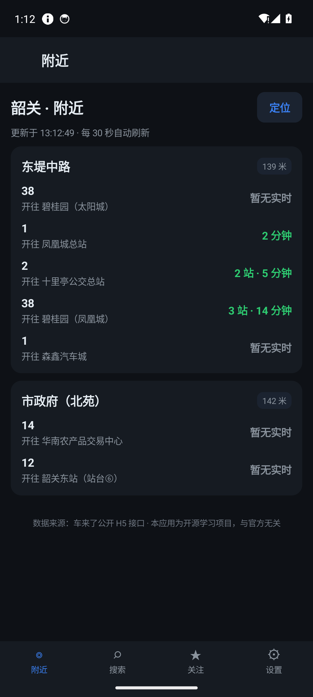
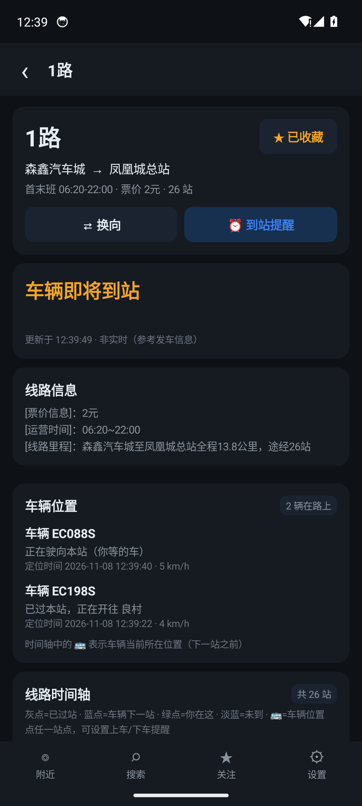
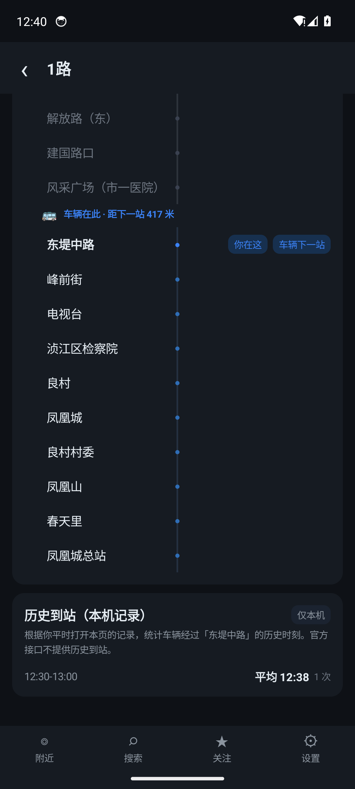
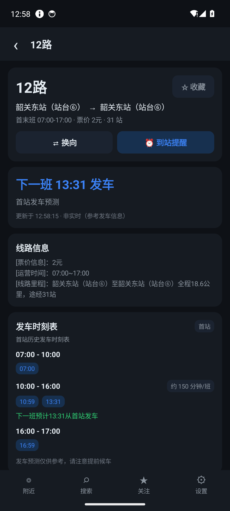
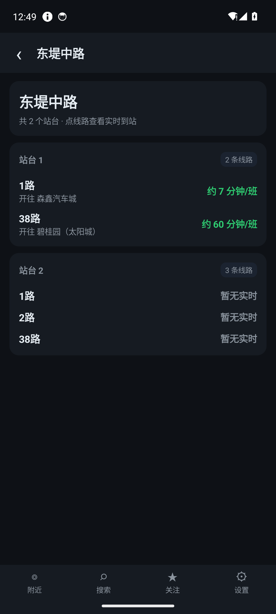
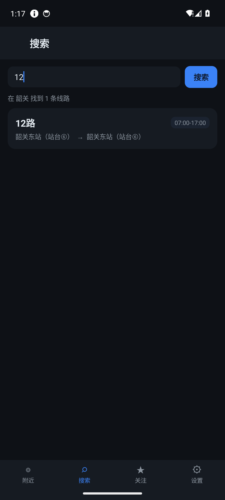
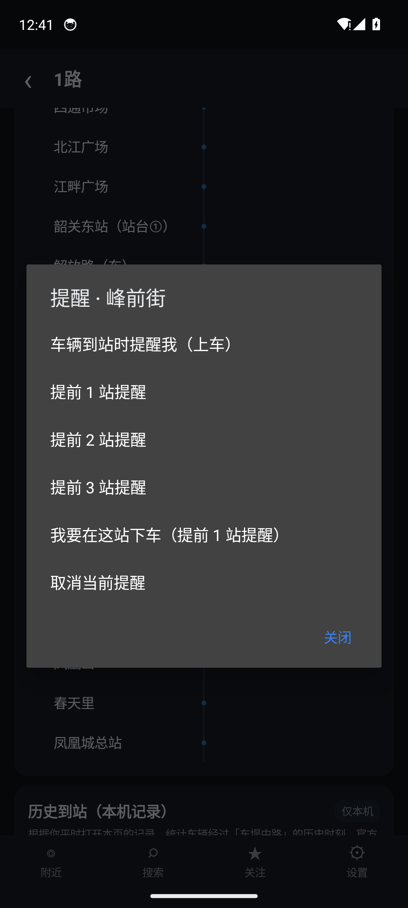
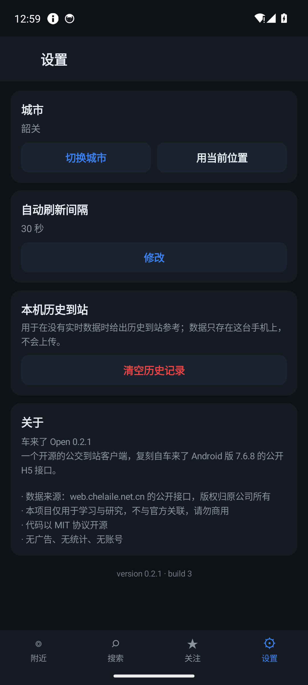
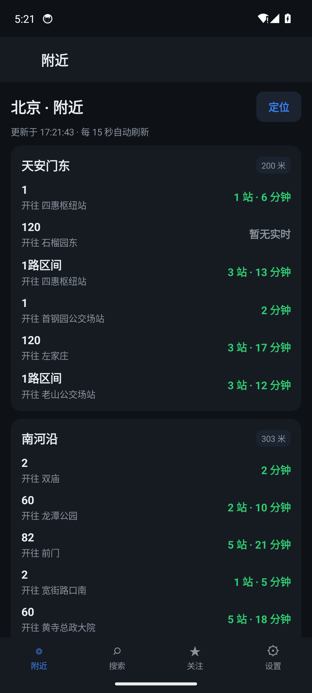
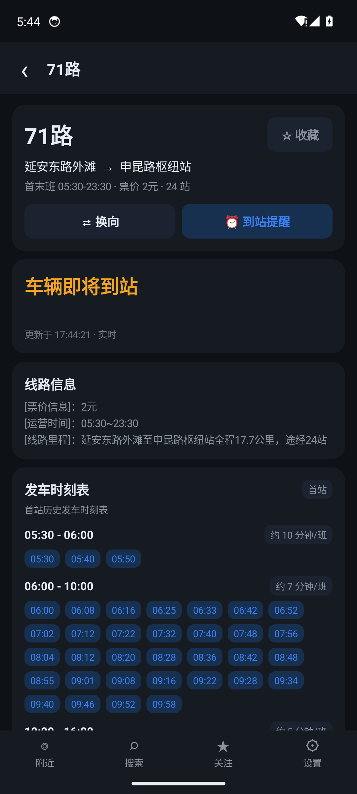

# Android 客户端（车来了 Open）

> 这是本项目的主要交付物：一个不依赖 Gradle、可以直接用 Android SDK 命令行构建的实时公交客户端。
> 目标应用为「车来了」Android 7.6.8（com.ygkj.chelaile.standard，versionCode 436），本项目与之无官方关联。

- **包名**：org.chelaileopen.app
- **版本**：0.2.2（versionCode 4）
- **最低系统**：Android 7.0（API 24）
- **编译/目标**：API 34
- **语言**：Java 11（无 Kotlin、无 AndroidX、无第三方依赖）
- **构建产物**：apps/android/build/chelaile-open-0.2.2.apk（约 70 KB）
- **仓库发布 APK**：release/chelaile-open-0.2.2.apk

## 1. 功能

| 功能 | 实现 |
| --- | --- |
| 附近线路 | 自动定位/手动城市 → 附近物理站 → 按站分组展示线路、距离、到站预测；30 秒自动刷新 |
| 自动定位 | 首次启动请求定位权限；30 秒内缓存、GPS/网络双 provider、12 秒超时；成功后反查城市并自动切换 |
| 多城市动态 | H5 静态站点 + App 明文实时接口；北京/上海等非韶关城市也能显示车辆位置与到站预测 |
| 线路搜索 | 下载整城线路表（本地缓存 24 小时）后按线路号精确/模糊过滤，离线可用 |
| 线路详情 | 首末班、票价、站数、当前车辆、最近站、完整站序时间轴、运营信息；非韶关用 App timeTable 补全动态车辆 |
| 实时到站 | 解析明文 stnStates 与 buses，支持“还有 N 站 / 即将到站 / 已过站 / 等待下一班” |
| 发车时刻表 | 调用 line!depTimeTable.action；无在途车时把 forecastDesc 转成“下一班 HH:MM 发车” |
| 换向 | 交换线路起终点并按反方向重新请求，targetOrder 同步重算 |
| 收藏 | 本机 SharedPreferences，关注页进入自动刷新，长按取消 |
| 上下车提醒 | 前台服务每 20 秒轮询；点时间轴任一站点设置“上车/提前 N 站/下车”提醒，通知带停止按钮 |
| 历史到站 | 本机 SQLite 记录车辆跨站时刻，按 30 分钟桶展示平均值与样本数，明确标注“本机记录” |
| 城市切换 | 499 个城市，支持拼音/中文搜索、热门城市、GPS 反查 |
| 深色 UI | 深色主题、底部四 Tab（附近/搜索/关注/设置）、无广告、无账号、无统计 |

截图见 docs/screenshots：

| 附近 | 线路 | 时间轴 | 发车时刻表 |
| --- | --- | --- | --- |
|  |  |  |  |

| 站点 | 搜索 | 提醒菜单 | 设置 |
| --- | --- | --- | --- |
|  |  |  |  |

| 北京（自动定位） | 上海 71 路 |
| --- | --- |
|  |  |

## 2. 构建与安装

### 2.1 依赖

- JDK 17（javac --release 11）
- Android SDK：platforms;android-34、build-tools;36.0.0、platform-tools
- 不需要 Gradle、Android Studio 或 AGP

build-tools;34.0.0 的 d8 8.2.2 对匿名内部类存在已知崩溃（NullPointerException: String.length()）。构建脚本会自动选择 SDK 中版本最高的 build-tools；本项目验证使用的是 **36.0.0**。

### 2.2 命令

    export ANDROID_SDK_ROOT=$HOME/android-sdk
    cd apps/android
    ./build.sh
    # 输出 build/chelaile-open-0.2.2.apk

    adb install -r build/chelaile-open-0.2.2.apk
    adb shell am start -n org.chelaileopen.app/.MainActivity

构建脚本的执行链：

1. aapt2 compile 编译 res/；
2. aapt2 link 生成 R.java 与资源 APK；
3. javac --release 11 编译 src/ + build/gen/；
4. d8 --release --min-api 24 生成 classes.dex；
5. zip 装回 APK，zipalign -f 4 对齐；
6. 首次构建自动生成 keystore/debug.keystore，apksigner 签名并打印证书。

注意：keystore/ 不应提交到仓库。发布版请替换为自己的签名密钥，并妥善保管。

### 2.3 模拟器

    # 需要 Android SDK 的 emulator 与 system-images;android-34;google_apis;x86_64
    ANDROID_SDK_ROOT/emulator/emulator -avd chelaile -no-window -no-audio -no-boot-anim       -gpu swiftshader_indirect -no-snapshot -wipe-data

    adb emu geo fix 113.591965 24.813761   # 韶关市政府附近
    adb shell pm grant org.chelaileopen.app android.permission.ACCESS_FINE_LOCATION
    adb shell pm grant org.chelaileopen.app android.permission.POST_NOTIFICATIONS

## 3. 代码结构

    apps/android/
    ├── AndroidManifest.xml
    ├── build.sh
    ├── res/
    │   ├── drawable/ic_launcher.xml      应用图标（蓝色公交矢量）
    │   ├── drawable/ic_stat_bus.xml      通知栏小图标
    │   └── values/{strings,colors,styles}.xml
    └── src/org/chelaileopen/app/
        ├── App.java                      Application 单例、prefs、线程池、线路表缓存、收藏
        ├── MainActivity.java             四 Tab + 页面栈 + 权限结果转发
        ├── core/
        │   ├── Api.java                  H5 + App 双参数网关（GET、剥壳、状态码、AES 解密、动态补全）
        │   ├── Crypto.java               MD5 / AES-256-ECB（Android JCE）
        │   ├── Models.java               线上 JSON → 领域对象
        │   ├── Format.java               ETA/距离/运营时间/时刻表文案
        │   └── Geo.java                  WGS-84 / GCJ-02 / BD-09 转换与 haversine
        ├── data/
        │   └── HistoryStore.java         SQLite 本机历史到站
        ├── service/
        │   └── ReminderService.java      前台服务 + 通知
        └── ui/
            ├── Ui.java                   深色组件工具（dp/卡片/按钮/间距）
            ├── Screen.java               页面基类
            ├── NearbyScreen.java / SearchScreen.java / FavoritesScreen.java / SettingsScreen.java
            ├── LineScreen.java           线路详情、时间轴、时刻表、提醒菜单
            ├── StationScreen.java        站台分组与线路入口
            ├── FlowLayout.java           发车时刻表班次 chip 的自动换行布局
            └── LocationHelper.java       定位权限、自动定位与 LocationManager

## 4. 协议客户端

core/Api.java 同时使用两套公共参数：H5 参数负责需要 AES 解密的线路/站点详情，App 参数负责明文实时车辆接口。两者请求同一个网关，响应外壳一致。

- **网关**：https://web.chelaile.net.cn
- **请求头**：Android Chrome UA、Referer: https://web.chelaile.net.cn/、Connection: close
- **H5 参数**：s=h5、v=9.1.2、vc=1、src=wechat_shaoguan、sign=1、userId/h5Id、cityId、geo_lat/geo_lng、lat/lng、gpstype=wgs
- **App 参数**：s=android、v=7.6.8、vc=436、src=android、sign=1、userId/h5Id、cityId、geo_lat/geo_lng、lat/lng、gpstype=wgs
- **响应壳**：\*\*YGKJ{...}YGKJ##；jsonr.status 00 成功、01 无数据（不抛异常）；城市列表等少数接口直接返回 {"data": ...}，客户端做了回退
- **H5 加密**：data.encryptResult 为 AES-256-ECB/PKCS#7 的 Base64 密文，密钥为 32 字节 ASCII 常量
- **签名**：cryptoSign 为有序 k=v&... + 盐的 MD5；当前服务端不校验，但按原协议发送
- **App 密文**：App 参数请求 encryptedLineDetail 会返回另一种密文（非 H5 AES-ECB），当前未解；因此不走这条路，改用 H5 静态详情 + App 明文 timeTable 合并

主要端点：

| 方法 | 端点 | 参数与用途 |
| --- | --- | --- |
| cities() | /cdatasource/citylist | 旧 App 参数，499 城市 |
| locateCity() | /cdatasource/citylist?type=gpsRealtimeCity | 旧 App 参数，GPS 反查城市名 |
| cityLines() | /api/bus/cityLineList | App 参数，整城线路表（本地搜索） |
| lineRoute() | /api/bus/line!lineRoute.action | App 参数，站序 + 轨迹（BD-09） |
| nearLines() | /api/bus/stop!nearlines.action | App 参数，明文附近线路与动态 stnStates |
| nearStations() | /api/bus/stop!nearPhysicalStns.action | App 参数，明文附近物理站 |
| lineDetail() | /api/bus/line!encryptedLineDetail.action | H5 参数，AES 解密；buses 为空时用 lineTimeTable 补全 |
| lineTimeTable() | /api/bus/line!timeTable.action | App 参数，明文动态 buses，只用于补全详情 |
| depTimeTable() | /api/bus/line!depTimeTable.action | H5 参数，首站发车时刻表（明文） |
| stationDetail() | /api/bus/stop!encryptedPhyStnDetail.action | H5 参数，AES 解密 |
| lineSummary() | /api/bus/line!summary.action | H5 参数，线路文字简介（可失败降级） |

### 4.1 多城市动态合并

- 北京/上海等非韶关城市，H5 encryptedLineDetail 返回完整站点表，但 buses=[]、realData=false。
- App line!timeTable.action 仍返回动态 buses：busId、order、nextStationName、lat/lng、distanceToSc、distanceToWaitStn、speed、timeStr、state、travels[]（含 arrivalTime、travelTime、recommTip）。
- Api.lineDetail 在 buses 为空时调用 lineTimeTable，把 buses 与 line.state/desc 合并进同一个 Detail；UI 不区分城市。动态补全失败时静默保留静态详情。
- 附近页直接使用 App stop!nearlines.action 的明文 nearLines；stnStates 含 arrivalTime(epoch ms)、travelTime(秒)、value(站数)、order、state。
- 已验证：北京 1 路（33 站、9 辆在路上）、上海 71 路（24 站、实时 ETA 与完整时刻表）；杭州/重庆在无车时段会显示 line.desc“等待发车/不在运营时间”。

## 5. 关键语义

### 5.1 到站与时间轴

- targetOrder：用户关注/最近站点的站序，用于计算 ETA。
- buses[].order：车辆**正在驶向的下一站**站序，不是已过站序号。
- “你在这”不使用服务端 nearStnOrder，而是用当前 GPS 对所有站点（优先 wgsLat/wgsLng，否则 BD-09→GCJ-02→WGS-84）计算几何最近站；同一位置打开 1 路/2 路/120 路都会落到同一站。nearStnOrder 只在坐标缺失时兜底。
- 绿点 chip 显示“你在这 · N 米”，距离为 haversine 到最近站。
- 时间轴高亮规则：
  - stop.order < bus.order：已过站（灰）
  - stop.order == bus.order：车辆下一站（蓝）
  - 用户站：绿点 + “你在这”
  - 其余：淡蓝未到
- 车辆 marker 插在 stop.order == bus.order 的行之前，文案“🚌 车辆在此 · 距下一站 N 米”。
- ETA 使用 stopsLeft = targetOrder - bus.order：小于 0 且 depDesc 非空 → “等待下一班”，否则“车辆已过站”；等于 0 → “车辆即将到站”；大于 0 → “还有 N 站”。

### 5.2 发车时刻表

depTable=1 的线路（如韶关 12、101、201、21、23A、23B）需要额外调用 line!depTimeTable.action。返回的 timetable 为分段数组：

- type=1：首段；type=0：中间预测段；type=2：末段；
- 每段含 fTime/eTime/depInterval/depIntervalTips/forecastDesc/schedules[]/times[]；
- 如果没有任何在途车，UI 用 forecastDesc 里的 HH:MM 把主 ETA 设为“下一班 HH:MM 发车”，并标注“首站发车预测”。

### 5.3 历史到站

上游没有公开历史到站接口；本机用 HistoryStore 记录两次刷新之间 bus.order 的增量，将跨过的每一站写入 SQLite（line_id, direction, station_order, station_name, bus_id, ts, clock_min）。UI 按 30 分钟桶聚合 AVG(clock_min) 与样本数，明确显示“历史到站（本机记录）/ 仅本机 / 官方接口不提供历史到站”。数据只存本机，不上传。

### 5.4 上下车提醒

ReminderService 是 dataSync 类型前台服务：

- 每 20 秒调用 lineDetail；
- 条件：存在 0 < bus.order <= stationOrder 且 stationOrder - bus.order <= advance；
- kind=board 生成“车辆即将到站/还有 N 站到 X，请准备上车”；
- kind=alight 生成“即将到达 X，请准备下车”；
- 触发后发高优先级通知并 stopSelf()；常驻通知带“停止提醒” action；
- 时间轴点任一站点 → 菜单可选“车辆到站时提醒我（上车）/提前 1–3 站/我要在这站下车（提前 1 站）”。
- 首次设置提醒时才请求 POST_NOTIFICATIONS；拒绝则 Toast 提示无法发送通知。

### 5.5 坐标

上游 lineRoute、nearLines 等返回 **BD-09**；nearPhysicalStns 请求需要 WGS-84。Geo 提供：

- wgs84ToGcj02 / gcj02ToWgs84（4 次迭代）
- bd09ToGcj02 / gcj02ToBd09 / bd09ToWgs84
- stationToWgs：优先 wgsLat/wgsLng，其次按 gpsType=="bd" 转换，否则原样

附近分组跳站点详情前，必须先把分组的 BD-09 坐标转 WGS-84 再查 nearPhysicalStns，否则会查到另一片区域。

## 6. 权限

| 权限 | 用途 |
| --- | --- |
| INTERNET / ACCESS_NETWORK_STATE | 请求公交数据 |
| ACCESS_FINE_LOCATION / ACCESS_COARSE_LOCATION | 附近站点、GPS 选城 |
| POST_NOTIFICATIONS | 到站提醒 |
| FOREGROUND_SERVICE / FOREGROUND_SERVICE_DATA_SYNC | 后台轮询提醒 |
| WAKE_LOCK | 保持轮询期间唤醒 |

首次启动自动请求定位权限（精确/近似）；授权后定位、反查城市并自动切换。拒绝定位仍可手动选城市或点“定位”重试。通知权限不在启动时请求，首次设置到站提醒时再请求，避免和定位权限弹窗竞争。

## 7. 验证清单（2026-11-08，Android 14 x86_64 模拟器）

| 项目 | 结果 |
| --- | --- |
| build.sh 从零构建 | ✅ 0.2.2，apksigner 校验通过 |
| 冷启动/权限 | ✅ 首次启动弹定位权限；Allow 后自动定位 |
| 自动定位韶关 | ✅ geo 113.591965,24.813761 → “韶关 · 附近” |
| 自动定位北京 | ✅ geo 116.397,39.908 → “北京 · 附近” |
| 附近动态 | ✅ 韶关东堤中路 139m；北京天安门东 200m；上海西藏中路 89m |
| “你在这”一致性 | ✅ 韶关 1/2 路均“东堤中路 · 144 米”；北京 1/120 路均天安门东（260/201m 为站台坐标差异） |
| 附近 → 站点详情 | ✅ BD-09→WGS-84 后命中 physicalStId |
| 站点 → 线路 | ✅ 站台 1/2 分组、线路 ETA |
| 线路详情（北京） | ✅ 1 路 33 站、9 辆在路上、主 ETA“还有 4 站” |
| 线路详情（上海） | ✅ 71 路 24 站、车辆即将到站、完整发车时刻表 |
| 线路时间轴 | ✅ 灰/蓝/淡蓝/绿、车辆 marker 位于下一站之前、“你在这 · N 米” |
| 发车时刻表 | ✅ 韶关 12 路分段；上海 71 路 05:30–06:00 约 10 分钟/班、06:00–10:00 约 7 分钟/班；长班次列表自动换行 |
| 到站提醒/通知权限 | ✅ 首次提醒弹通知权限；Allow 后前台服务 foregroundId=1001；上车/下车文案正确 |
| 关注/长按取消 | ✅ 弹窗“取消关注 1路？” |
| 清空历史 | ✅ 弹窗 + Toast“已清空历史记录” |
| 城市切换/刷新间隔 | ✅ 热门城市、拼音搜索、10/15/30/60 秒 |

## 8. 已知限制

1. **加密线路详情仍是 H5 通道**：H5 encryptedLineDetail 只对韶关返回 buses；其它城市用 H5 静态站点 + App 明文 timeTable 补全动态车辆。App 参数下的 encrypted 端点密文格式不同，当前未解。
2. **动态覆盖随城市和时段变化**：北京、上海已实测有车；杭州、重庆等城市在无车时段会返回空 buses，页面显示“等待发车/不在运营时间”，不是客户端故障。
3. **自动定位按城市名匹配**：GPS 反查只返回 cityName，客户端再按名称查 cityId；极少数边界或重名场景可能选错，可在设置中手动切换。
4. **夜间空窗**：0:00–5:00 上游几乎无车，页面会显示“等待下一班/首班未发”，这是真实数据状态。
5. **搜索是客户端过滤**：encryptedNSearch 参数未逆清；首次需下载整城线路表，北京约 1.5 MB。
6. **时刻表并非所有线路都有**：lineDetail.depTable=1 时才请求 depTimeTable；其它线路只显示实时/固定班次描述。
7. **历史到站只在本机**：依赖用户多次打开线路页，样本少时只显示“还没有记录”。
8. **提醒依赖前台服务**：系统可能因省电策略回收；轮询间隔 20 秒，精度有限。
9. **未实现**：地图选站、地铁换乘、账号登录、支付、广告、官方推送、语音搜索。
10. **接口稳定性**：上游可能随时改参数/加签/停服；本项目只做学习研究，不保证长期可用。

## 9. 安全与合规

- 不包含原 App 的 dex/so/资源，不重新分发原二进制；
- 不绕过登录、付费、广告或任何授权数据；
- 无埋点、无账号、无上传；收藏与历史只在本机；
- 请求频率保持低（附近 30 秒、提醒 20 秒），不做批量抓取；
- 接口数据版权归原公司所有，代码以 MIT 发布，仅供学习研究，请勿商用。

如权利方认为本项目侵犯权益，请提交 issue，我们会立即处理。
